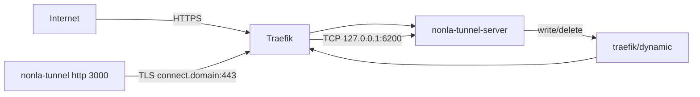

# Nonla Tunnel

[](https://github.com/devnonla/nonla-tunnel/actions/workflows/ci.yml)
[](LICENSE)
[](https://github.com/devnonla/nonla-tunnel/pkgs/container/nonla-tunnel)

Expose local HTTP apps through your own VPS — subdomain routing, Traefik TLS, and a ngrok-style CLI.



CLI only — no web dashboard. Designed to be driven by scripts and AI agents: commands never prompt (`uninstall` takes `--yes`), and `http -d` returns as soon as the public URL is live.

## Quick Start

### 1. DNS (required before deploy)

You need **two A records** pointing to the same VPS IP:

| Type | Name / Host | Value | Covers |
|---|---|---|---|
| A | `*.tunnel.example.com` | `YOUR_VPS_IP` | every tunnel subdomain (`my-api.…`) |
| A | `tunnel.example.com` | `YOUR_VPS_IP` | apex — serves `/install` (wildcard does **not** match it) |

The wildcard also covers `connect.tunnel.example.com`, the TLS control channel clients connect to.

Verify after propagation:

```bash
dig +short tunnel.example.com
dig +short anything.tunnel.example.com
# Both should return YOUR_VPS_IP
```

### 2. Deploy server (GitHub Container Registry)

Traefik must already run on the host (or as a container with `network_mode: host`) and watch a dynamic directory.

```bash
mkdir -p nonla-tunnel && cd nonla-tunnel
curl -fsSL -o docker-compose.yml \
  https://raw.githubusercontent.com/devnonla/nonla-tunnel/main/docker-compose.yml
curl -fsSL -o .env.example \
  https://raw.githubusercontent.com/devnonla/nonla-tunnel/main/.env.example
cp .env.example .env
# DOMAIN, AUTH_TOKEN
# TRAEFIK_DYNAMIC_DIR = host path Traefik watches (e.g. /home/docker/traefik/dynamic)
docker compose pull
docker compose up -d
```

Image: [`ghcr.io/devnonla/nonla-tunnel`](https://github.com/devnonla/nonla-tunnel/pkgs/container/nonla-tunnel) — `:latest` (newest release), `:0.1.0` / `:0.1` (pinned), `:main` (unreleased). Set `IMAGE_TAG` in `.env` to pin a version.

To build from source instead: clone the repo and run `docker compose up -d --build`.

`AUTH_TOKEN` is the shared **admin** token (≥16 chars, `openssl rand -hex 24`; generated on first start if empty, never logged). Don't hand it to agents — give each agent a one-time invite instead.

### 3. Onboard an agent (one-time invite)

On the server, create an invite (single use, expires in 24h by default):

```bash
docker compose exec nonla-tunnel nonla-tunnel-server invite --label agent-1
# nti_9233…
# Give the agent one of:
#   curl -sSL https://tunnel.example.com/install | bash -s -- --invite nti_9233…
#   nonla-tunnel enroll --server connect.tunnel.example.com:443 --invite nti_9233…
```

The agent runs the one-liner. It installs `nonla-tunnel`, connects over TLS and trades the invite for its own credential (`ntc_…`), which is the only thing saved to `~/.nonla-tunnel/config.yaml`. The invite is burned on first use, so a leaked/used invite is worthless.

The Docker image ships a Linux client binary for the host arch. On macOS (or other platforms without a prebuilt binary), the install script downloads source from the server and builds `nonla-tunnel` with Cargo (installs Rust automatically if needed).

Manage credentials:

```bash
docker compose exec nonla-tunnel nonla-tunnel-server clients            # issued credentials + pending invites
docker compose exec nonla-tunnel nonla-tunnel-server revoke c_a692b754  # revoke; live tunnels drop within ~15s
docker compose exec nonla-tunnel nonla-tunnel-server revoke i_04cf7bf6  # delete an unused invite
```

See what is connected right now and drop tunnels:

```bash
docker compose exec nonla-tunnel nonla-tunnel-server sessions
# NAME     CLIENT                      PEER                  UPTIME  REQS      IN     OUT  HEALTH
# agent1   c_b1d68812 agent-1 (host)   203.0.113.7:59294        5s     4  12.5KB    402B  ok
# admin1   admin-token                 127.0.0.1:60532          5s     0      0B      0B  ok

docker compose exec nonla-tunnel nonla-tunnel-server sessions --json    # same, as JSON
docker compose exec nonla-tunnel nonla-tunnel-server kick agent1        # drop it; reconnects refused for 1m, so the client exits
docker compose exec nonla-tunnel nonla-tunnel-server kick agent1 --ban 0   # just reset the connection; the client reconnects
docker compose exec nonla-tunnel nonla-tunnel-server kick agent1 --ban 1h  # keep the name off for an hour
```

`PEER` is the agent's real address (Traefik passes it via PROXY protocol). To shut an agent out permanently, `revoke` its credential; `kick` keeps the credential. To hand a name to a different agent, `revoke` the old one, then `nonla-tunnel-server release-name <name>`.

The CLI talks to the running server over a local Unix socket (`admin.sock`, `0600`, next to `server.yaml`) — there is no network admin API.

### 4. Open a tunnel

```bash
nonla-tunnel http 3000
# Forwarding  https://tunnel-xxxxxxxx.tunnel.example.com -> http://localhost:3000

nonla-tunnel http 3000 --name my-api
# Forwarding  https://my-api.tunnel.example.com -> http://localhost:3000
```

## CLI (`nonla-tunnel`)

```bash
nonla-tunnel enroll --server connect.DOMAIN --invite nti_…     # one-time invite → own credential (TLS :443)
nonla-tunnel config set --server connect.DOMAIN --token TOKEN   # set a token directly (admin token / existing credential)
nonla-tunnel config set --server HOST:6200 --token TOKEN --no-tls  # plaintext, localhost/dev only
nonla-tunnel config show
nonla-tunnel http 3000 [--name NAME]          # foreground (Ctrl+C to stop)
nonla-tunnel http 3000 --name my-app -d       # background, exits when connected
nonla-tunnel status                           # config + background tunnels
nonla-tunnel stop [NAME]                      # stop background tunnel(s)
nonla-tunnel upgrade
nonla-tunnel uninstall --yes
```

Client state lives in `~/.nonla-tunnel/` (all files `0600`): `config.yaml`, `claims/<name>.key`, and `tunnels/<name>.pid` / `tunnels/<name>.log` for background tunnels.

Tunnel names must be one lowercase DNS label: `a-z`, `0-9`, `-`, 1–63 chars, no leading/trailing `-`. `dashboard`, `connect`, `api`, `www`, `admin`, `install`, `download` are reserved.

### Using it from an agent

Setup, once (the operator gives you the invite):

```bash
curl -sSL https://<domain>/install | bash -s -- --invite nti_…
# or, already installed:   nonla-tunnel enroll --server connect.<domain> --invite nti_…
# or via env:              NONLA_INVITE=nti_… nonla-tunnel enroll --server connect.<domain>
```

- `enroll` exits `0` and prints `Enrolled as c_…`; exits `1` with `Authentication failed: invalid or expired invite` if the invite was already used, expired or deleted — ask for a new one, never retry the same code.
- `config set --token nti_…` is refused: invites only work with `enroll`.

Then use the detached mode so the command returns instead of blocking:

```bash
nonla-tunnel http 3000 --name my-app -d
```

- Exits `0` once connected and prints `Forwarding  https://my-app.<domain> -> http://localhost:3000`; parse the URL from the line starting with `Forwarding  `.
- Exits `1` right away and prints the tunnel log if the credential is rejected (`Authentication failed: Invalid token` — e.g. revoked). Auth errors are never retried; a revoked agent needs a new invite.
- Network errors (server down, DNS) are retried with backoff. If not connected within 15s it prints `Still connecting…` and exits `0` with the tunnel left running — check `~/.nonla-tunnel/tunnels/<name>.log`, or `nonla-tunnel stop <name>` to give up.
- Always pass `--name` so the URL is predictable and `nonla-tunnel stop <name>` can clean up.
- Starting a name that is already running in the background fails; stop it first.
- A name belongs to the first client that used it (its `claims/<name>.key`). Another machine/user cannot take it over even with the same token — it gets `Authentication failed: tunnel name '<name>' is in use by another client` (exit `1`). Pick another name. Claims are released after 30 days unused.
- `uninstall` needs `--yes` to skip the confirmation prompt.

## Security model

- **Per-agent credentials via one-time invites.** An invite (`nti_…`) is single-use and expires (default 24h, max 30d). Enrolling burns it and issues a random per-client credential (`ntc_…`) that can be listed and revoked individually; a revoked credential's live tunnels are dropped within ~15s. The server stores only SHA-256 hashes, in `credentials.json` (`0600`) next to `server.yaml`.
- **Shared admin token** (`AUTH_TOKEN`) also authenticates directly, for the operator. It cannot be revoked per client — rotate it by changing `AUTH_TOKEN`.
- **Control channel is TLS**: Traefik terminates TLS for `connect.<domain>` on the HTTPS entrypoint (TCP router, `HostSNI`) and forwards to the server on `127.0.0.1:6200`. With Traefik enabled the server binds both ports to `127.0.0.1` only; set `NONLA_BIND_ADDR=0.0.0.0` only if you really need direct plaintext access.
- **Tunnel names are owned** via per-name claim keys (server stores only SHA-256 hashes in `claims.json`, `0600`, next to `server.yaml`).
- **Names are validated** server-side before anything reaches Traefik YAML or a hostname.
- Wrong tokens and invites are answered after a 1s delay; a client IP is blocked for 60s after 10 failures. Behind Traefik the real IP comes from PROXY protocol v2 (only trusted from loopback peers, so it cannot be spoofed remotely). Agents behind one NAT share an IP and thus the block.
- **Admin operations** (`sessions`, `kick`, `release-name`) go through a `0600` Unix socket; only the server's user (or root) can use them.
- **Limits:** 128 concurrent requests per tunnel (`rate_limit.max_connections_per_client`, excess → `503`), 100 req/s per tunnel, 256 pending control connections (8 per IP), 5s to authenticate.
- **Let's Encrypt quota:** each new tunnel name gets its own certificate via the cert resolver (Let's Encrypt allows ~50 new certificates per registered domain per week). Prefer stable `--name`s; routers idle for 24h are removed automatically. For many short-lived names, give Traefik a wildcard certificate for `*.<domain>` (DNS challenge) instead.
- Downloads (`/install`, `scripts/install.sh`, `upgrade`) are verified against `SHA256SUMS`.

## Traefik

nonla-tunnel only writes YAML into the Traefik dynamic directory:

- `_nonla-tunnel-base.yml` — shared upstream + apex router (`<domain>` → `http://127.0.0.1:6210`, serves `/install` and `/download/*`) + TLS TCP router `connect.<domain>` → `127.0.0.1:6200`
- `nonla-tunnel-{name}.yml` — per-client router, written on connect

Client routers are kept on disconnect/restart so reconnects don't hit a 404 while Traefik reloads. Traefik provisions Let's Encrypt certificates per host. Uses `network_mode: host` so Traefik reaches `http://127.0.0.1:6210`.

Traefik needs an HTTPS entrypoint (default name `websecure`, port 443) and a cert resolver (default `letsencrypt`). Set `traefik.cert_resolver: ""` to use Traefik's default certificate instead.

## Configuration

See [`configs/server.example.yaml`](configs/server.example.yaml). Docker uses env vars:

| Env | Role |
|---|---|
| `DOMAIN` / `NONLA_DOMAIN` | Base domain |
| `AUTH_TOKEN` / `NONLA_TOKEN` | Shared admin token (agents use invites) |
| `TRAEFIK_DYNAMIC_DIR` | Host path to Traefik dynamic configs |
| `NONLA_CLIENTS_DIR` | Client binaries for `/download` |
| `NONLA_BIND_ADDR` | Listener address (default `127.0.0.1` with Traefik, else `0.0.0.0`) |

## Development

```bash
cargo build --release
cargo test --workspace
cargo run -p nonla-tunnel-server -- start --domain localhost --force
cargo run -p nonla-tunnel-client -- http 3000 --name my-app
```

## Contributing

See [CONTRIBUTING.md](CONTRIBUTING.md). Please read the [Code of Conduct](CODE_OF_CONDUCT.md) and [Security Policy](SECURITY.md) before opening issues or PRs.

## Changelog

See [CHANGELOG.md](CHANGELOG.md).

## License

MIT — see [LICENSE](LICENSE).
